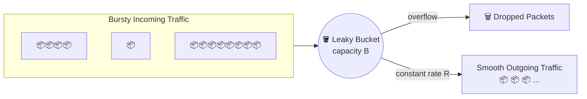

<div align="center">

# 🌐 Experiment 9 — Leaky Bucket Algorithm

### Congestion Control • Traffic Shaping • Constant Output Rate

[](https://www.python.org/)
[](#)
[](#)
[](#)

</div>

[](https://raw.githubusercontent.com/andreasbm/readme/master/assets/lines/rainbow.gif)

# 🎯 Aim

To implement congestion control using the **Leaky Bucket Algorithm** and transmit packets at a fixed rate.

[](https://raw.githubusercontent.com/andreasbm/readme/master/assets/lines/rainbow.gif)

# 📝 Description

The **Leaky Bucket Algorithm** is a congestion-control / traffic-shaping technique used in computer networks to smooth out bursty traffic before it enters the network. Incoming packets are stored in a **fixed-size buffer (the "bucket")** and transmitted — or "leaked" — at a **constant output rate**, regardless of how bursty the arrivals are.

- If packets arrive **faster** than the output rate, they queue up temporarily in the bucket.
- If the bucket becomes **full**, any further incoming packets are **dropped** (overflow condition).
- The net effect: however irregular the input traffic is, the output traffic leaving the bucket is always smooth and rate-limited.



## ⚙️ Algorithm

**📋 Click to view the Leaky Bucket Algorithm**

<details>
<summary>Step-by-Step Algorithm</summary>

1. **Start.**
2. **Initialize:**
   - `B` = bucket capacity (in packets or bytes)
   - `R` = output rate (packets/sec)
   - `bucket = 0` (current number of packets in the bucket)
3. **For each time unit** (or packet arrival):
   - **a. If new packet(s) arrive:**
     - If `(bucket + packet_size) ≤ B` → add the packets to the bucket.
     - Else → drop the excess packets (overflow condition).
   - **b. Leak packets:**
     - Transmit up to `R` packets from the bucket.
     - Decrease bucket count: `bucket = bucket − R`.
     - If `bucket < 0` → set `bucket = 0`.
4. **Repeat** Step 3 for each time unit.
5. **End.**

</details>

## 🔑 Key Function

| Function | Purpose |
|----------|---------|
| `leaky_bucket(bucket_size, output_rate, incoming_packets)` | Simulates the bucket over a sequence of time units: adds each unit's incoming packets (dropping any overflow beyond `bucket_size`), then "leaks" up to `output_rate` packets out of the bucket, printing the bucket's state after each step |

**Configuration used:** `bucket_size = 10`, `output_rate = 3`, `incoming_packets = [4, 3, 8, 1, 2]`

> 💻 **Full source code:** [`source_code.py`](./source_code.py)

[](https://raw.githubusercontent.com/andreasbm/readme/master/assets/lines/rainbow.gif)

## 📊 Simulation Walkthrough

| Time | Incoming | Bucket After Arrival | Dropped | Sent (Leaked) | Remaining |
|:----:|:--------:|:---------------------:|:-------:|:--------------:|:---------:|
| 1 | 4 | 4 | 0 | 3 | 1 |
| 2 | 3 | 4 | 0 | 3 | 1 |
| 3 | 8 | 9 | 0 | 3 | 6 |
| 4 | 1 | 7 | 0 | 3 | 4 |
| 5 | 2 | 6 | 0 | 3 | 3 |

With a bucket capacity of 10 and an output rate of 3 packets/sec, none of the bursts in this sample sequence are large enough to overflow the bucket — but each time unit still only ever transmits a maximum of 3 packets, smoothing the bursty input of `[4, 3, 8, 1, 2]` into a steady outflow.

[](https://raw.githubusercontent.com/andreasbm/readme/master/assets/lines/rainbow.gif)

## 🚀 Applications

- Traffic shaping in ATM and packet-switched networks.
- Rate-limiting APIs and network interfaces to prevent bursts from overwhelming downstream systems.
- Enforcing Quality of Service (QoS) guarantees by smoothing variable bit-rate traffic.
- Preventing network congestion caused by bursty applications (e.g., video streaming).

[](https://raw.githubusercontent.com/andreasbm/readme/master/assets/lines/rainbow.gif)

# 📤 Output

> ℹ️ **Note:** This program is fully deterministic (no random behavior), so the output below is the exact, actual result of running the extracted `source_code.py` with the PDF's own example input. The PDF's *Output* section was blank, but this is the one and only output the code can ever produce for the given inputs.

```
Time 1: Incoming packets = 4
  Bucket state after arrival: 4 packets (Dropped: 0)
  Sent: 3, Remaining in bucket: 1

Time 2: Incoming packets = 3
  Bucket state after arrival: 4 packets (Dropped: 0)
  Sent: 3, Remaining in bucket: 1

Time 3: Incoming packets = 8
  Bucket state after arrival: 9 packets (Dropped: 0)
  Sent: 3, Remaining in bucket: 6

Time 4: Incoming packets = 1
  Bucket state after arrival: 7 packets (Dropped: 0)
  Sent: 3, Remaining in bucket: 4

Time 5: Incoming packets = 2
  Bucket state after arrival: 6 packets (Dropped: 0)
  Sent: 3, Remaining in bucket: 3
```

[](https://raw.githubusercontent.com/andreasbm/readme/master/assets/lines/rainbow.gif)

<div align="center">

### Made with ❤️ by **Thrinath**
📂 Part of the [`Sector5_Labs`](https://github.com/thrinathpolanki/Sector5_Labs) — Computer Networks Lab

</div>
