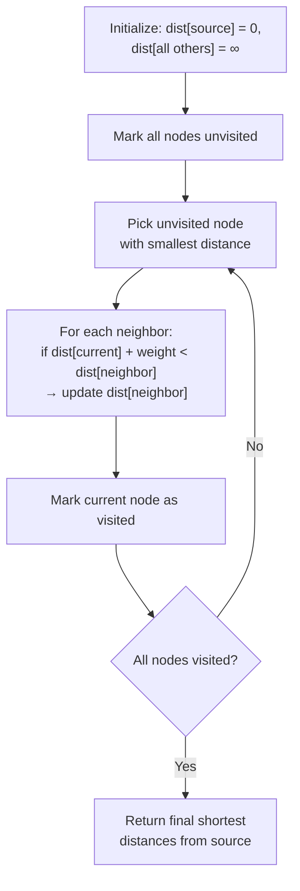
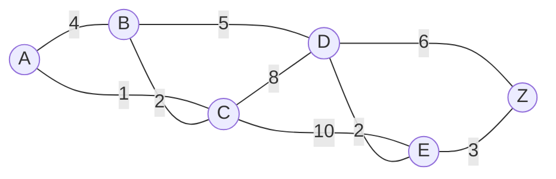

<div align="center">

# 🌐 Experiment 10 — Dijkstra's Shortest Path Algorithm

### Routing • Weighted Graphs • Priority Queue

[](https://www.python.org/)
[](#)
[](#)
[](#)

</div>

[](https://raw.githubusercontent.com/andreasbm/readme/master/assets/lines/rainbow.gif)

# 🎯 Aim

To implement **Dijkstra's algorithm** to find the shortest path between vertices in a weighted graph.

[](https://raw.githubusercontent.com/andreasbm/readme/master/assets/lines/rainbow.gif)

# 📝 Description

**Dijkstra's algorithm** is a shortest-path **routing algorithm** used to find the minimum-cost path from a single **source vertex** to all other vertices in a weighted graph — a direct model of how routers compute least-cost paths in a network topology, where edge weights represent link costs, delay, or distance.

The algorithm starts at the source and repeatedly:

1. Selects the **unvisited** vertex with the smallest known distance.
2. **Relaxes** (updates) the distances of its neighbors if a shorter path through the current vertex is found.
3. Marks the current vertex as **visited** — once visited, its shortest distance is final and never changes again.



## ⚙️ Algorithm

**📋 Click to view the Dijkstra Algorithm Steps**

<details>
<summary>Step-by-Step Algorithm</summary>

1. **Initialize distances**
   - Set distance to the source = `0`.
   - Set distance to all other nodes = `∞` (infinity).
2. **Mark all nodes as unvisited** — create a set of unvisited nodes.
3. **Choose the unvisited node with the smallest distance** — initially, this is the source.
4. **Update distances to neighbors** — for the current node, calculate the distance to each unvisited neighbor; if the new distance is less than the stored distance, update it.
5. **Mark the current node as visited** — once visited, a node's shortest distance is finalized.
6. **Repeat** steps 3–5 until all nodes are visited, or the target node's distance is finalized.

</details>

## 🔑 Key Function

| Function | Purpose |
|----------|---------|
| `dijkstra(graph, source)` | Computes shortest distances from `source` to every other node using a **min-heap priority queue** (`heapq`): repeatedly pops the closest unfinalized node, relaxes its outgoing edges, and pushes any improved distances back onto the heap |

The graph is represented as an **adjacency list**: `{node: [(neighbor, weight), ...]}`.

> 💻 **Full source code:** [`source_code.py`](./source_code.py)

[](https://raw.githubusercontent.com/andreasbm/readme/master/assets/lines/rainbow.gif)

## 🗺️ Example Graph



## 🚀 Applications

- **Link-state routing protocols** such as OSPF and IS-IS, which use Dijkstra's algorithm directly to compute shortest routing paths.
- GPS navigation and road-network shortest-path computation.
- Network topology optimization and cost-minimization problems.
- Any scenario requiring the shortest/cheapest path in a graph with non-negative edge weights.

[](https://raw.githubusercontent.com/andreasbm/readme/master/assets/lines/rainbow.gif)

# 📤 Output

> ℹ️ **Note:** This program is fully deterministic, so the output below is the exact, actual result of running the extracted `source_code.py` with the PDF's own example graph (source vertex `'A'`). The PDF's *Output* section was blank, but this is the one and only output the code can ever produce for this input.

```
{'A': 0, 'B': 3, 'C': 1, 'D': 8, 'E': 10, 'Z': 13}
```

**Shortest paths from A:**

| Destination | Shortest Distance | Path |
|:-----------:|:------------------:|------|
| A | 0 | — (source) |
| C | 1 | A → C |
| B | 3 | A → C → B |
| D | 8 | A → C → B → D |
| E | 10 | A → C → B → D → E |
| Z | 13 | A → C → B → D → E → Z |

[](https://raw.githubusercontent.com/andreasbm/readme/master/assets/lines/rainbow.gif)

<div align="center">

### Made with ❤️ by **Thrinath**
📂 Part of the [`Sector5_Labs`](https://github.com/thrinathpolanki/Sector5_Labs) — Computer Networks Lab

</div>
